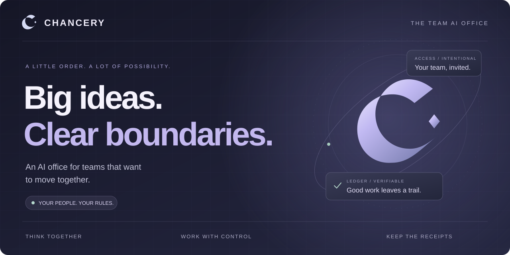

<div align="center">



<br />

**Your people. Your AI. Your rules.**

Bring your team’s thinking, AI work, approvals, and spending into one Office.<br />
Give good ideas room to grow. Keep control of the details that matter.

<br />

**CHNC · Contract address**

```text
0xa05496e2100cc14920d969f918343f863eae209e
```

[Open Chancery](https://trychancery.com) &nbsp; · &nbsp; [View contract ↗](https://robinhoodchain.blockscout.com/address/0xa05496e2100cc14920d969f918343f863eae209e)

<br />

[The Office](#a-place-for-your-whole-team) &nbsp; · &nbsp; [The workflow](#from-idea-to-receipt) &nbsp; · &nbsp; [Security](#built-for-trust-down-to-the-details) &nbsp; · &nbsp; [More possibilities](#give-your-office-more-room)

<br />


</div>

## A place for your whole team

Research the next move. Draft the proposal. Make the decision together. Chancery puts AI to work inside a workspace with clear permissions, shared budgets, and a record your team can verify.

<table>
<tr>
<td width="50%" valign="top">

### 01 / An Office of your own

Invite your people, assign roles, and give everyone a clear place in the team. Switch between Offices while keeping each workspace’s access and activity separate.

</td>
<td width="50%" valign="top">

### 02 / AI with a little order

Choose from your Office’s approved models. Set the policy, check the price, and get to work. Keep an encrypted conversation history or choose a temporary conversation.

</td>
</tr>
<tr>
<td width="50%" valign="top">

### 03 / Ambition with a budget

Set Office and individual spending limits. Approve a maximum price before a request runs. Keep changes to team access, policies, and budgets behind owner approvals.

</td>
<td width="50%" valign="top">

### 04 / A paper trail, upgraded

Follow AI usage into the Ledger. Inspect signed receipts, verify their signatures, and export statements. Give your team a clear view of what happened and what it cost.

</td>
</tr>
</table>

## From idea to receipt

One flow connects the work to its permissions, price, and proof.



<p align="center"><sub>Illustrated request flow · policy → quote → work → receipt</sub></p>

## Models

Chancery adds models in waves, so every model in the catalog has been checked against Office pricing, receipts and policy before your team can use it.

**Wave 1 · Core** and **Wave 2 · Alternatives** are live.

| Wave | Model | Model ID | Maker |
| :--- | :--- | :--- | :--- |
| 1 · Core | **GPT-6.1 Sol** | `gpt-6.1-sol` | OpenAI |
| 1 · Core | **Claude Sonnet 5.5** | `claude-sonnet-5.5` | Anthropic |
| 1 · Core | **Gemini 3.8 Flash** | `gemini-3.8-flash` | Google |
| 2 · Alternatives | **DeepSeek V4.1 Flash** | `deepseek/deepseek-v4.1-flash` | DeepSeek |
| 2 · Alternatives | **GLM-5.3** | `glm-5.3` | Z.ai |
| 2 · Alternatives | **Kimi K3.1 Pro** | `moonshotai/kimi-k3.1-pro` | Moonshot AI |

Each Office can narrow this list further with its own model allowlist in Settings.

## Built for trust, down to the details

Security lives in how your team signs in, how work is stored, who can approve a change, and how every charge is recorded.

| What matters | How Chancery handles it |
| :--- | :--- |
| **Your identity** | Passkey and wallet sign-in with verified challenges. Sessions use HttpOnly cookies, with Secure cookies in production. |
| **Your team’s boundaries** | Office permissions and role-scoped Ledger access. Sensitive governance changes require owner approval. |
| **Your saved work** | Stored conversation content and saved AI responses use AES-256-GCM authenticated encryption. |
| **Your secrets** | Secret guards check for seed phrases, private keys, and recognized API-key patterns. Office policy can require these checks. |
| **Your budget** | Signed quotes, explicit maximum-price approval, and spending limits at the Office and individual level. |
| **Your records** | Ed25519-signed receipts, Merkle proofs, and visible settlement and anchoring status. |

<details>
<summary><strong>A closer look at the engineering</strong></summary>

<br />

- **Context-bound encryption.** Stored ciphertext is authenticated against its Office and record context.
- **Protected sessions.** Session tokens are hashed in storage. State-changing API requests require the configured origin; authenticated writes use CSRF protection.
- **Precise accounting.** Integer-based amounts and transactional reservations keep concurrent requests inside shared budgets.
- **Intentional retries.** Stable request IDs let the team inspect a request’s outcome without starting the same AI job again.
- **Checkable evidence.** Receipt signatures, Merkle inclusion proofs, and onchain confirmation are exposed as distinct checks.
- **Human authority.** Treasury changes require owner signatures; the backend does not sign those approvals on the team’s behalf.

</details>

## Give your Office more room

**Coming soon to Chancery:** more ways for your team to collaborate, delegate, and make decisions together.

| Capability | What it brings to the team |
| :--- | :--- |
| **Encrypted Rooms** | Private text conversations with device-held keys, per-device key wrapping, reviewed device identities, and key rotation. Sealed Room messages stay separate from AI requests. |
| **AI Clerks** | Recurring text jobs with model rules, spending caps, and ask-first approvals. Pause, resume, or revoke a Clerk as the work changes. |
| **Transaction drafts** | Prepare a transaction, inspect its explanation and simulation, and queue it for human signatures. |
| **Signed Minutes** | Turn a decision into an Office-visible record with an encrypted body, a signed hash, and exportable verification details. |

<br />

<div align="center">


<details>
<summary><strong>Build your Office</strong></summary>

Use the Node version in `.nvmrc`, then run `npm ci --ignore-scripts`, `npm run build`, and `npm test`.

[Build, test and deploy](DEVELOPMENT.md) · [Security engineering](SECURITY.md) · [Changes](CHANGELOG.md)

</details>

### Big ideas deserve a well-run Office.

**Make it Chancery.**

</div>
